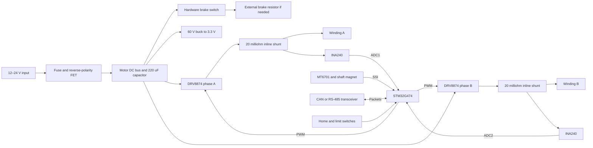

# NEMA 17 FOC controller: design and 100-unit cost estimate

Date: 2026-09-21. Currency: USD.

Recommended architecture: **STM32G474CBT6 + two DRV8874 H-bridges + two INA240 current amplifiers + MT6701 magnetic encoder**, with CAN as the base population and an RS-485 alternative. This provides measured-current, two-phase FOC, with no ESP32 or radio.

The planning estimate is **$16.47 electronic BOM, $22.22 assembled PCB, and $26.06 delivered, programmed and calibrated controller kit**, at 100 units. Budget roughly **$24–32 per kit**, excluding motor, engineering, tax and enclosure. A local braking resistor adds an estimated $2–5 when required; a shared brake at the power supply can serve multiple nodes instead. These are estimates, not a JLCPCB quotation.

This is a component-level engineering design and cost study. It includes circuit connections, component values, peripheral allocation, control strategy, mechanical constraints and production assumptions. It has not been captured/routed in CAD, built or measured; no Gerbers, assembly placement file or working FOC firmware are represented as complete. The BOM identifies the main orderable parts and labels supporting-part allowances explicitly.

## Design basis

| Item | Proposed specification |
| --- | --- |
| Motor | Two-phase, four-wire bipolar NEMA 17; accessible rear shaft for magnet |
| Supply | 12–24 V nominal; design for 24 V supplies up to 26.4 V; no 48 V support |
| Current | Continuous design target: `sqrt(iA²+iB²) <= 2 A`; each phase may reach 2 A peak |
| Current interpretation | At constant-speed sinusoidal operation with a 2 A vector, each phase is 1.414 A RMS. At standstill one winding can carry 2 A DC. This is not a 2 A RMS-per-phase rating. |
| Feedback | Absolute single-turn 14-bit encoder; turn counting while powered; home switch for persistent multi-turn reference |
| Control | Current/torque, velocity and position modes; local acceleration-limited moves and homing |
| Timing | 20 kHz PWM/current-loop target; 1 kHz velocity and position service; encoder read each current cycle |
| Network | Classical CAN at 1 Mbit/s, or half-duplex RS-485; differential pair plus signal ground |
| Packaging | Approximately 42 × 42 mm, four-layer PCB, sensor on motor-facing side |
| User interface | Network configuration, status LED, SWD/UART pads, two limit inputs; no display/buttons/USB connector |
| Environment | Initial qualification target 0–50°C ambient; motor heat and enclosure determine current derating |

NEMA 17 specifies the mounting envelope, not winding current, inductance, voltage or rear mounting details. The selected motor's winding ratings still govern the current setting. Board size and hole pattern must be checked against its actual rear end-cap drawing.

## Reference products and architecture choice

| Reference | What it establishes for this design |
| --- | --- |
| [Grafito CANStepper](https://grafito.in/shop/products/canstepper-adapter-board/) | Useful packaging/network reference. It lists ESP32-C3, TMC2209 and MT6701, with a 200 Hz outer position loop; it is not the measured-phase-current FOC architecture proposed here. Its listed board price is ₹2,899, approximately $30 on the page. |
| [Makerbase SERVO42D product](https://makerbase3d.com/product/servo42d-nema17-closed-loop-stepper-motor-driver-cnc-3d-printer-for-gen_l-foc-quiet-and-efficient/) | Lists CAN and RS-485 variants, from $22.99. Confirm the selected variant and included accessories before comparing prices. |
| [Makerbase hardware repository](https://github.com/makerbase-motor/MKS-SERVO42D-57D/tree/master/Hardware) | The 42D CAN V1.0_003 schematic labels N32L403KBQ7, MT6816CT-ACD, four EG3013 gate drivers and four AP4008QD dual-MOSFET packages. This validates the four-half-bridge/two-winding topology. It is a more discrete implementation. |
| [ElectroPeak link supplied in the request](https://electropeak.com/mks-servo42c-nema17-closed-loop-stepper-motor-driver) | The current page renders a ZDT NEMA17 product with options, despite the MKS URL. Its displayed entry price is therefore not used as a verified MKS42C price. |

The Makerbase repository currently contains schematics, manuals, host examples and a PC control utility. The inspected tree did not expose the motor-control firmware source. A source archive for the PC utility does not establish that the embedded FOC firmware is reusable. Budget for our own firmware and check licenses before reusing third-party implementation.

At this quantity, buying SERVO42D is likely cheaper once development is counted. A custom board is justified by firmware ownership, a specific motion protocol, integration with this repository, or mechanical requirements.

## Block diagram



## Electrical implementation

**Power and protection.** Use a 3 A input fuse as the initial selection, subject to the motor's bus-current and inrush measurements. Q1 is DMP6023LE-13, with drain toward the fused input and source toward the motor bus. Add 100 kΩ gate-to-ground and a 12 V gate-source Zener, cathode to source. This orientation admits initial power through the body diode and then through the enhanced channel. This is reverse-polarity protection, not reverse-current blocking; the conducting FET allows regenerated energy back onto a shared DC bus.

Provide 220 µF/50 V bulk capacitance and 4.7 µF/50 V plus 100 nF/50 V at each bridge. Keep these switching loops short. Ceramic values mean effective capacitance at bias, not just the marking. Use LMR16006XDDCR to generate 3.3 V, with a starting 22 µH shielded inductor rated for at least 1.5 A saturation, SS16 catch diode, 100 nF bootstrap capacitor, local input ceramics and 22 µF output ceramic. Its 0.765 V nominal feedback reference gives approximately 3.30 V with 33.2 kΩ upper and 10 kΩ lower feedback resistors. Allocate 200 mA normal rail load and check 300 mA transients, including CAN dominant current. Final inductor and capacitor choices require the regulator's stability/current-limit checks. [TI regulator datasheet](https://www.ti.com/lit/ds/symlink/lmr16006.pdf)

Design the normal bus to stay below 30 V during braking and verify switching overshoot below the bridge's 37 V operating ceiling. The DRV8874's 40 V absolute maximum is a damage boundary. A 26 V TVS can clamp above 40 V at its rated pulse current, so a nominal TVS voltage alone does not prove protection. Reserve a TVS footprint and a small protection-component allowance; fit a specific TVS only after coordinating its full I–V curve with source impedance and the measured transient. The active brake and local decoupling are the base energy-management measures.

**Regeneration.** Include a brake controller independent of the MCU: LMV331 comparator on 3.3 V, TLV431A tied as a 1.24 V reference and biased through 4.7 kΩ, plus a second DMP6023LE high-side switch. Comparator `+` senses VM through 221 kΩ/10 kΩ, with 1 MΩ positive feedback from its output; comparator `−` receives 1.24 V. Use a 1 kΩ output pull-up. Drive an MMBT3904 base through 22 kΩ, add 100 kΩ base-emitter, and connect its collector through 22 kΩ to the brake P-FET gate. The FET has a 100 kΩ gate-source pull-up and a 12 V gate-source clamp. Source goes to VM; drain goes through the external brake resistor to ground. Initial thresholds are about 28.9 V on and 28.2 V off, with component tolerances and output loading to be included at schematic review. The comparator inputs remain near 1.24 V, within their supply range. [Comparator](https://www.ti.com/lit/ds/symlink/lmv331.pdf), [reference](https://www.ti.com/lit/ds/symlink/tlv431a.pdf)

A starting external resistor is 47 Ω, rated for at least 25 W with the specified mounting. At 29 V it absorbs about 18 W while on. This only covers loads whose regenerative power/energy fit that envelope; size it from the actual inertia, speed and stopping time. For multiple axes, a suitably sized common brake can replace individual resistors. Mount power resistors away from the encoder and motor electronics. The brake electronics are included in the base BOM; the power resistor is a separate $2–5 allowance.

For scale, `Ecap = 0.5*C*(29²−24²)` is only **0.029 J** for 220 µF. An assumed rotor inertia of `6e−6 kg·m²` at 1,000 RPM stores **0.033 J**, before adding load inertia. Bulk capacitance alone is insufficient for many stops. Disabling PWM also cannot guarantee that an externally driven motor stops feeding the bus. [TI motor-drive energy-management discussion](https://www.ti.com/document-viewer/lit/html/SSZTBS1/GUID-4E20E0C2-9D92-42A8-B86E-D05394FAD546)

**Winding drive.** Use one DRV8874 per winding, with PMODE high for IN1/IN2 PWM control. Add the specified 22 nF/50 V flying capacitor and 100 nF/16 V VCP-to-VM capacitor to each. Ground their exposed pads with thermal vias. Set IMODE through 62 kΩ to ground, VREF to 3.3 V, and IPROPI through 2.7 kΩ to ground: the nominal backup chopping threshold is approximately `3.3/(450e−6*2700) = 2.72 A`. Its tolerance and sensing limitations make it a backup to the 2 A software limit. Tie both open-drain nFAULT signals to a pulled-up, active-low TIM1 break input; latch faults in firmware. A separate shared nSLEEP GPIO has a physical pull-down. [TI DRV8874 datasheet](https://www.ti.com/lit/ds/symlink/drv8874.pdf)

The modulation is defined as follows, where D is requested absolute winding voltage divided by measured bus voltage:

| Requested voltage | IN1 | IN2 | States used |
| --- | --- | --- | --- |
| Positive | High | Low for fraction D; high otherwise | Forward drive and low-side brake |
| Negative | Low for fraction D; high otherwise | High | Reverse drive and low-side brake |
| Zero voltage | High | High | Low-side brake |
| Disabled/fault | nSLEEP low; timer break forces inputs low immediately | — | Outputs disabled |

Update both inputs coherently at timer boundaries, including sign changes. Start with duty limited to 95%, anti-windup, and no field weakening. Zero applied voltage is distinct from zero torque; the current regulator determines the voltage needed for its torque target.

**Signed current feedback.** Put a 20 mΩ, 1%, ≥0.5 W shunt between OUT1 and its winding terminal on each bridge. INA240A1 inputs use Kelvin traces across that shunt, with IN+ on the bridge side. Power at 3.3 V; tie REF1 to 3.3 V and REF2 to ground. Add 47 Ω/1 nF at each ADC input as a starting output filter. Then:

```
Vadc = 1.65 + 20 * 0.020 * Iphase
Iphase = (Vadc - calibrated_zero) / 0.400
```

The output is 0.85–2.45 V at ±2 A, leaving margin for transients. A 12-bit, 3.3 V ADC resolves about 2.0 mA/count. Each shunt dissipates at most 0.080 W at 2 A DC. The amplifier's wide common-mode range and PWM rejection make inline sensing practical. [TI INA240 datasheet](https://www.ti.com/lit/ds/symlink/ina240.pdf)

IPROPI reports low-side current magnitude and has unobservable states; voltage polarity is not always current polarity during regeneration or zero crossings. The two inline amplifiers provide the signed currents needed by the proposed FOC loop. Removing them is a change to the sensing/control design, not a like-for-like $4 saving.

**MCU allocation.** The following port allocation is compatible with the STM32G474CBT6 datasheet. It reserves SPI1, two ADCs and all four TIM1 outputs without sharing the CAN pins. Alternate functions must also be encoded in the eventual CubeMX/HAL configuration. [ST pin and alternate-function tables](https://www.st.com/resource/en/datasheet/stm32g474cb.pdf)

| Function | Port allocation |
| --- | --- |
| A bridge IN1/IN2 | PA8 / PA9, TIM1 CH1/CH2, AF6 |
| B bridge IN1/IN2 | PA10 / PA11, TIM1 CH3 AF6 / CH4 AF11 |
| A/B current | PA0 ADC1_IN1 / PA1 ADC2_IN2 |
| Encoder | PA4 GPIO CSN; PA5 SPI1_SCK AF5; PA6 SPI1_MISO AF5 |
| CAN RX/TX | PB8 / PB9, FDCAN1 AF9 |
| RS-485 alternative | PA2/PA3 USART2 TX/RX AF7; PB6 GPIO DE and /RE |
| Bridge enable / fault | PB2 GPIO nSLEEP; PB12 TIM1_BKIN AF6 |
| Bus voltage / temperature | PB0 ADC1_IN15 / PB1 ADC1_IN12 |
| Limits | PC13 / PC14 GPIO inputs; no LSE crystal |
| LED | PB5 GPIO |
| Clock | PF0/PF1, 8 MHz crystal |
| Programming | PA13/PA14 SWD, NRST, 3.3 V reference and ground pads |

PB8 is also BOOT0. Program option bytes to boot from flash independently of the pin before enabling the CAN population; a recessive CAN RX level must not select the bootloader. Disable the UCPD dead-battery pull-downs when initializing PB6 for RS-485 direction control. PA11 is occupied by TIM1, so USB is not supported by this pin plan. Decouple each MCU supply pin and VDDA/VREF according to ST's recommendations; keep a continuous ground plane.

Sense VM through 100 kΩ/8.2 kΩ, 0.1%, with approximately 10 nF filtering: 40 V maps to about 3.03 V. Add a 10 kΩ NTC divider close to the bridges. Use 3.3 V limit inputs with pull-ups, series resistors, RC filtering and connector ESD protection; 24 V proximity sensors need a separate level-shifting input option.

## Encoder and mechanical design

Place the MT6701 centered over a **diametrically magnetized** 6 × 2 mm shaft magnet. Start with 1–2 mm clearance between magnet and package, adjustable by the carrier/standoffs; this is a mechanical starting point, not a substitute for measuring valid field strength. Fit only the encoder and its local bypass on the motor-facing PCB side. Keep the buck inductor, bridge current loops, steel brackets and power wiring away from the sensing region. Verify the field-status bits with the motor energized at worst-case current. A motor without a usable rear shaft needs a different carrier/motor or external encoder.

For the SOP8 encoder, connect pins 1 (VDD) and 2 (MODE) to 3.3 V, pin 4 to ground, and pins 8/7/6 to CSN/CLK/DO respectively; bypass locally with 100 nF. Leave unused OUT and PUSH outputs unconnected. Transfer exactly 24 clock pulses per SSI reading, MSB first: 14 angle bits, 4 status bits, and CRC6 using `x^6+x+1`. A 5 MHz clock takes 4.8 µs; sample on falling edges and follow the specified chip-select timing. Check CRC, field-too-high/low and overspeed status. Store correction data in the MCU's flash: the encoder's EEPROM requires more than 4.5 V for programming and is not programmed by this 3.3 V design. [MT6701 manufacturer datasheet](https://www.novosns.com/enfiles/MT6701_Rev.1.8.pdf)

14 bits gives **0.02197° quantization**, not that much absolute accuracy. The datasheet lists typical ±1° and maximum ±1.5° integral nonlinearity under its stated conditions. A 1.8° stepper has 50 electrical cycles per mechanical turn; 1° mechanical error becomes 50° electrical error. Sensor mounting and calibration therefore materially affect torque quality.

Calibrate sensor zero, direction, motor electrical offset and a periodic correction table (initially 512 entries) using slow forward/reverse sweeps. Average the directions to reduce lag effects and reject bad/missing-magnet data. An external reference is needed to establish absolute accuracy: motor detent torque and sweep error limit what self-calibration can prove. Set a prototype acceptance target of ≤0.2° static position error under a specified modest load, measured independently; do not advertise this before testing.

Target 42 × 42 mm, 1.6 mm FR-4, four layers: outer component/power layers and continuous internal ground with internal power/routing. Use 1 oz copper initially, wide winding paths/pours, Kelvin sense routing, and exposed-pad thermal-via arrays. Keep mounting metal clear of live pads. NEMA 17's usual front mounting pitch does not guarantee the rear bolt pattern.

At a 2 A current vector, typical bridge conduction loss is approximately `0.20*(iA²+iB²) = 0.80 W` across both bridges; use about 1.2 W for a preliminary hot-resistance allowance, then add switching and logic losses. Budget roughly 2 W board heat for initial thermal design. Locked-rotor orientations may concentrate most bridge dissipation in one IC. A 3 A vector raises conduction loss by 2.25×; that requires a separate thermal qualification. The motor backplate may be hot, so qualify the actual mount and enclosure.

## Firmware and network behavior

Implement the two-phase transform directly, without a three-phase Clarke transform:

```
theta_e = pole_pairs * corrected_mechanical_angle + electrical_offset
id =  iA*cos(theta_e) + iB*sin(theta_e)
iq = -iA*sin(theta_e) + iB*cos(theta_e)

vd = PI_d(id_target - id) + optional_model_feedforward_d
vq = PI_q(iq_target - iq) + optional_model_feedforward_q

vA = vd*cos(theta_e) - vq*sin(theta_e)
vB = vd*sin(theta_e) + vq*cos(theta_e)
```

Use `id_target=0` initially. The velocity loop generates limited `iq_target`; the position loop and trajectory generator generate the velocity demand. Current is a torque proxy until torque constant and detent effects are characterized. Enforce current-vector, velocity, acceleration and voltage limits with anti-windup. Identify phase resistance/inductance at low current to establish initial loop gains. A 1.8° motor uses 50 pole pairs; verify rather than applying that value to a 0.9° motor.

Synchronize both ADCs to the PWM and timestamp the encoder sample. Select a quiet sample window after the actual switching edges; the two sign-magnitude bridge waveforms have at most four distinct switching instants per 50 µs period, allowing a longest global quiet interval of at least 12.5 µs. Place the ADC trigger late in that interval, with a starting 10 µs settling budget. INA240's 9.6 µs large-step settling figure is typical, not a guaranteed PWM blanking time. Validate the complete sense/filter waveform on the prototype, adjust PWM/duty limits if necessary, and account for the trigger's varying phase and computation delay. Do not assume an arbitrary timer-center sample is always valid. Use a timer synchronized to TIM1 for the internal ADC trigger; it needs no external pin.

Start current-loop crossover around 500 Hz, then tune from measured response. At 600 RPM, a 50-pole-pair motor has 500 Hz electrical frequency and 40 current updates per cycle. This is a timing feasibility calculation, not a guaranteed loaded-speed specification: winding inductance, resistance, back-EMF and supply voltage dominate the torque-speed curve. Compensate measured encoder/control latency using estimated velocity, with bounds near zero speed and reversals.

Start disabled. Calibration and valid feedback precede enabling current. Include CRC-checked nonvolatile configuration, current-zero calibration, following-error detection, encoder fault handling, temperature derating, bus-voltage monitoring, command watchdog and latched driver faults. On a command timeout, apply the configured bounded stop then disable or hold, according to the application's requirement. No network parsing or flash writing belongs in the current interrupt. Provide SWD recovery and a compact UART bootloader/update path; reserve flash for configuration and update recovery rather than assuming a dual-image scheme fits 128 KB.

**CAN base:** STM32 FDCAN in Classical CAN mode, TCAN332DR at 3.3 V, two parallel three-pin CANH/CANL/GND connectors, and a jumper-selectable 120 Ω termination (two 60.4 Ω resistors plus midpoint capacitor are a layout option). Only the physical ends are terminated. Use twisted pair, short stubs, connector ESD protection and a common signal reference. This base design is not galvanically isolated. [TI transceiver datasheet](https://www.ti.com/lit/ds/symlink/tcan332.pdf)

Define a small versioned protocol with node IDs 1–63, enable/mode commands, target position/velocity/current, current/velocity/acceleration limits, status/faults, calibration and configuration. One possible setpoint frame is mode byte, sequence byte, signed 32-bit target and unsigned 16-bit limit; document units explicitly (position/velocity in Q16.16 turns or turns/s, current in mA). Reserve a broadcast synchronization frame and queue timestamped targets locally for coordinated motion. This is a custom protocol, not an assertion of CANopen compatibility. At about 130 bits per frame, 16 axes each sending a 100 Hz command and 100 Hz status consume approximately 42% of a 1 Mbit/s bus before extra traffic. Keep fast control on the node.

**RS-485 variant:** populate SN65HVD75DR and UART/DE routing instead of CAN. Its SOIC8 pinout is different; use distinct footprints or explicit population links. Pull DE low at reset and switch direction only after the UART's last stop bit. Use a single master, addressed requests, bounded replies and CRC16. Modbus RTU is an option if interoperability is wanted; define a register map and poll-rate budget before implementation. Fit termination at the two ends and, if needed, failsafe bias at one network location. Use the transceiver datasheet's A/B truth table when labeling connectors. [TI RS-485 datasheet](https://www.ti.com/lit/ds/symlink/sn65hvd75.pdf)

The existing repository firmware is USB JSON-RPC with TMC2209 step generation, as documented in [firmware/README.md](../../firmware/README.md). Its host command semantics and trajectory logic may be reusable. Its StepEngine/TMC current-control backend is not an FOC implementation. Add a distinct FOC backend and a host bridge translating existing JSON-RPC commands into bounded binary network messages; budget that integration separately from the hardware BOM.

## Cost at 100 units

Prices below were checked on 2026-09-21. Most major-part prices come directly from JLCPCB's public part-page data; the regulator and RS-485 alternative use LCSC listings. The selected major parts displayed supplier stock sufficient for the nominal 100-board build when inspected, but no inventory is reserved and supplier stock is not a guarantee of immediate assembly availability. Supporting passives, connectors and mechanical parts remain engineering allowances. The exact sources and quantity tiers are recorded in [bom.csv](bom.csv), with the JLCPCB observations retained in [price_snapshot.json](price_snapshot.json). Confirm procurement costs, part classifications and lead times in the actual assembly quote.

The G474 is selected partly for its current sourcing price: [STM32G474CBT6 is $3.0485](https://jlcpcb.com/partdetail/STM32G474CBT6/C730123) at the applicable 100-piece tier, whereas [STM32G431CBT6 is $6.5316](https://jlcpcb.com/partdetail/STM32G431CBT6/C529355). A lower-end MCU is therefore not automatically cheaper. This design uses the G474's own pinout; any future substitution needs a pin and peripheral review.

| Electronic BOM group | Per CAN board |
| --- | ---: |
| STM32G474CBT6 | $3.05 |
| Two DRV8874 | $1.62 |
| Two INA240A1 | $3.93 |
| MT6701CT-STD-R | $1.29 |
| TCAN332DR | $1.07 |
| Buck IC, inductor, catch diode and buck passives | $0.72 |
| Reverse FET, input protection allowance and bulk capacitor | $1.06 |
| Shunts, crystal, bridge/logic passives and bus protection | $1.29 |
| Power/motor/bus connectors and auxiliary I/O | $1.50 |
| Brake-control electronics and resistor connector | $0.95 |
| **Electronic BOM** | **$16.47** |

An RS-485-only board replaces the $1.0661 CAN transceiver with a $0.3680 part, giving **$15.77 BOM** and roughly **$0.73 less per finished kit** after allowances. Both interfaces fitted would add another connector pair/protection group and assembly; allow roughly $1–2 above the CAN version, subject to layout. They cannot share one bus pair while operating simultaneously.

| Manufacturing stage | Per board | 100-board lot |
| --- | ---: | ---: |
| Electronic BOM | $16.47 | $1,647 |
| Component attrition/procurement allowance, 3% | $0.49 | $49 |
| Four-layer PCB fabrication allowance | $1.50 | $150 |
| Assembly, fixtures, inspection and handling | $3.76 | $376 |
| **Assembled board subtotal** | **$22.22** | **$2,222** |
| Magnet and mounting kit | $0.90 | $90 |
| Programming, motor mounting, calibration and functional test allowance | $1.50 | $150 |
| Rework reserve, 2% of assembled subtotal | $0.44 | $44 |
| Shipping allowance, destination unspecified | $1.00 | $100 |
| **Delivered controller kit, CAN** | **$26.06** | **$2,606** |
| **Delivered controller kit, RS-485** | **$25.33** | **$2,533** |

Manufacturing uses Standard two-sided assembly because the encoder faces the motor. The calculator assumes 50 unique part types, 330 SMT joints and 16 through-hole joints per board. These are planning counts, not counts from a finished CAD export. It includes $51.12 setup, $16.42 stencil, $1.53 per feeder, $0.0016 per SMT joint, $0.0164 per through-hole joint, rigid-board fixtures and a conservative X-ray allowance for driver thermal pads. The SMT charge already exceeds the published minimum, so the minimum is not charged again. [JLCPCB fee schedule](https://jlcpcb.com/help/article/pcb-assembly-price), [assembly capabilities](https://jlcpcb.com/capabilities/pcb-assembly-capabilities)

The X-ray allowance is $98/lot if both driver packages require inspection; the quote determines applicability. Components' feeder losses/minimum purchase quantities can exceed the percentage allowance. Actual panelization may change fixtures, area and assembly charges. Economic one-sided assembly plus local encoder installation is a possible saving only after costing that local work and validating the process.

The $1.50 test allowance assumes three minutes at $30/hour with an existing fixture and automated routine. A process taking ten minutes at $60/hour costs $10/board, raising the kit estimate to about $34.56. Calibration after attaching the final magnet/motor cannot be replaced by a board-only electrical test. If shipping bare boards to customers, move the motor-dependent calibration into a documented commissioning routine.

Run `python3 docs/nema17-foc/cost_estimate.py` to regenerate [cost_summary.csv](cost_summary.csv). The script calculates both interface variants without combining incompatible population costs. Rounded range: **$24–32 per tested kit**, or **$2,400–3,200 for 100**, before any required external brake resistors. This is a procurement/assembly planning range, not a statistical confidence interval.

Allow another **$600–1,200** in first-project cash for prototype spins and a programming/test fixture; this is an engineering allowance, not a vendor price. An illustrative 120–250 hours at $100/hour for schematic/layout, FOC/network firmware, bring-up and qualification adds $12,000–25,000 of engineering, or $120–250 per unit if charged entirely to this first batch. Exclude that only when comparing recurring manufacturing cost. Motor, PSU, host adapter, cables, enclosure, brake resistor, optional heat spreader, taxes/duties and certification are outside the kit total.

The largest remaining cost reductions worth evaluating are an assembly plan with fewer operations and a discrete power stage with a redesigned low-side sensing scheme. The latter needs new PWM sampling/reconstruction work. A TMC2209 outer position-loop design changes the requested FOC capability; it is not the proposed cost-down path. A sub-$10 fully tested custom controller at 100 units is not supported by this estimate.

## Prototype and production release criteria

Build 5–10 prototypes before releasing 100. The following physical checks remain necessary to turn this design into a manufacturing release:

1. Capture the circuits in CAD, check pin mappings and option bytes, run ERC/DRC, and review power/thermal layout and the actual motor fit. Export a fully specified BOM, CPL, Gerbers and assembly drawings for a firm quote.
2. Bring up rails and disabled-state behavior using a current-limited supply. Verify reverse polarity, gate clamp voltages, brake hysteresis/startup and driver fault shutdown.
3. Compare both current channels with a calibrated current measurement in both directions, through zero crossings and at winding-current peaks; scope PWM-edge settling across duty range. Verify the hardware trip and software limit independently.
4. Characterize encoder error with the motor off and energized; test magnet displacement, missing magnet and CRC faults. Validate electrical alignment and the correction table against an independent angle reference.
5. Tune current, velocity and position loops under actual load. Record following error, settling, hold behavior, load disturbances, torque-speed curve and stall recovery. Confirm stability with latency and saturation included.
6. Thermal-soak the worst static rotor orientation and a running case at maximum qualified current, supply and ambient, with the intended motor/enclosure. Derive the continuous current rating and derating curve from measurements.
7. Test regeneration at worst load inertia and externally driven motion. Measure bus voltage and switch overshoot; qualify the resistor's pulse/average dissipation and shared-supply behavior.
8. Exercise the intended CAN/RS-485 node count, cable length, termination, timeouts, unplugging and recovery. Verify power-up never enables unintended motion and that corrupt updates have a recovery path.
9. Freeze firmware/configuration versions and test limits. Program unique IDs, store per-board current offsets and motor-dependent calibration with CRC, and save a production test record per unit.

The analytical checks behind this proposal cover component voltage/current compatibility, signed-current observability, pin allocation, encoder scaling, thermal first estimates, regeneration energy and manufacturing arithmetic. They do not establish a measured current rating, position accuracy, EMI performance or production yield.
