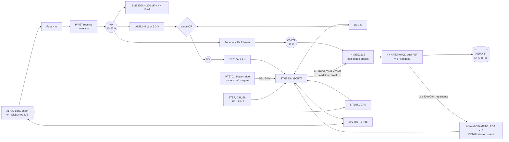

# hexaservo42 — low-cost closed-loop FOC driver for NEMA 17 steppers

A 42 × 42 mm board that bolts to the back of a NEMA 17 stepper and turns it
into a bus-controlled servo: magnetic absolute encoder, true field-oriented
current control, CAN **and** RS-485 on the same daisy-chain connector, USB-C
for setup. No ESP32, no radio.

| | |
|---|---|
| Supply | 10–26 V (12 / 24 V nominal), reverse-polarity protected, fused |
| Phase current | 3 A peak / ~2 A RMS continuous per phase |
| Power stage | 2 discrete H-bridges: 8 × 40 V 13 mΩ MOSFETs, 4 × half-bridge gate drivers, 11 V gate rail |
| Control | FOC: 20 kHz current loop on id/iq, 5 kHz velocity/position loops, on-board trajectory planner |
| Feedback | MT6701 14-bit absolute magnetic encoder (SSI), calibrated against the motor's own 200 detents; two low-side shunts through the MCU's internal PGAs |
| MCU | STM32G431CBT6 (Cortex-M4F 170 MHz, FDCAN, USB, 3 op-amps, 2 ADCs) |
| Interfaces | CAN 2.0/CAN-FD, RS-485 (both populated, firmware-selected), USB-C (CDC + DFU), STEP/DIR/EN, 2 limit inputs |
| **Cost @ 100** | **$6.40 BOM · $9.76 per assembled board from JLCPCB · ≈ $14.60 per complete unit landed in the US** (duty is a quarter of that) |

Files:

- `bom.csv` — full BOM with LCSC part numbers, side, mount type and pad counts
- `cost_model.py` — prices the BOM against live JLCPCB stock and applies JLCPCB's fee table
  (`python3 cost_model.py`, `--scenario economic`, `--qty 250`, `--refresh`)
- `prices.json` — price/stock snapshot taken 2026-09-21

This is an architecture- and schematic-level design (every part chosen, every MCU
pin assigned, the numbers worked). Schematic capture and layout in KiCad are the
next step; see [Next steps](#next-steps).

---

## 1. What the reference products do

| | Grafito CANStepper | MKS SERVO42D | ZDT Emm42-class board (the electropeak listing) |
|---|---|---|---|
| MCU | ESP32-C3 | Nations N32L403KB (M4F, 64 MHz) | "32-bit ARM" |
| Power stage | TMC2209 step/dir driver IC | 4 × EG3013 gate drivers + 4 × AP4008QD dual FETs | "8 MOSFETs", dual H-bridge |
| Current sensing | inside the TMC2209 (not visible to the MCU) | 2 × 50 mΩ shunts + GS8632 op-amp | "precision current sensor" |
| Encoder | MT6701 | MT6816 (14-bit SPI) | 14-bit magnetic |
| Control | 200 Hz outer position loop around an open-loop chopper — *not* FOC | FOC (loop rate not published) | FOC, "20 kHz+ feedback" |
| Bus | CAN (TCAN3413), USB-C | CAN (TJA1051T/3) **or** RS-485, separate SKUs | pulse / UART / RS-485 / CAN variants |
| Supply / current | 5–24 V, 2 A RMS | 12–24 V, 3 A | 7–32 V, 3 A |
| Extras | 2 limit inputs | OLED + 3 buttons, opto-isolated STEP/DIR/EN, 5 V gate drive | — |
| Retail (listing price) | ₹2,899 ≈ $33 | from $22.99 | $10.95 |

The MKS schematic is public
([MKS-SERVO42D-57D/Hardware](https://github.com/makerbase-motor/MKS-SERVO42D-57D/tree/master/Hardware))
and is the closest reference: it proves that a discrete 8-FET stage, shunts and
a small M4 fit on 42 mm and deliver FOC for a few dollars of silicon. The
Grafito board shows the cheaper-looking alternative — a TMC2209 plus an
encoder — but that architecture cannot do FOC: the MCU never controls or sees
the phase currents, so it can only nudge step pulses at a few hundred hertz.

**What this design takes from them:** the MKS power-stage topology and part
families (they are the cheapest parts JLCPCB stocks in volume), the Grafito
board's USB-C and limit inputs. **What it changes:** a proper 11 V gate rail
instead of 5 V gate drive, gate drivers that default to *all FETs off*, hardware
dead-time and break protection from the MCU's advanced timers, current sensing
that works at standstill, CAN and RS-485 on one board, USB, reverse-polarity
protection, and no OLED/buttons/optos.

---

## 2. Architecture



### Key decisions

**Discrete FETs rather than an integrated driver.** The cheap integrated
H-bridges JLCPCB stocks (TB67H450 at $0.34, A4950) have 0.6 Ω total
on-resistance: at 2 A RMS that is ~2.4 W per chip, two chips, on a board bolted
to a hot motor. Eight 13 mΩ FETs dissipate ~0.6 W in total, switching losses
included, for $0.78 with their drivers. TI's DRV8962 (four half-bridges with
current-sense outputs) would do the job in one package but is $9.25 at JLCPCB —
more than this entire BOM. TMC2209/TMC2240-class step/dir drivers are ruled out
because FOC needs direct control of both phase voltages.

**STM32G431 rather than the cheapest possible MCU.** It is the most expensive
part on the board ($2.49, 39 % of the BOM) and still the right call at 100
units: FPU at 170 MHz, FDCAN, crystal-less USB with a ROM DFU bootloader, two
ADCs that sample both phases simultaneously, three op-amps with programmable
gain (no external current-sense amplifiers or reference buffer), comparators
wired internally to the timers' break inputs, first-class PlatformIO/STM32Cube
support (this repo already builds STM32 targets with PlatformIO), and ST's
motor-control reference designs use exactly this part. The AT32F423 or N32L403
would save ~$1.40 per board — $140 on the whole run — in exchange for a vendor
SDK, a single ADC, external op-amps and weeks of extra firmware work. See
[cost-down options](#cost-down-options).

**Eight drive signals, not four.** MKS ties each driver's HIN and /LIN together
so four MCU pins drive four half-bridges. That leaves no way to switch a
bridge off (input low = low-side FET on) and relies on the driver's 130 ns dead
time. Here each half-bridge gets separate HIN/LIN from complementary
advanced-timer outputs (TIM1 CH1-3/CH1N-3N plus a synchronised TIM8 CH1/CH1N):
programmable dead time, a hardware break input that forces every FET off within
nanoseconds of a comparator trip, and — because the EG2132's inputs are
active-high with internal pull-downs — all eight FETs are off whenever the MCU
is in reset, unprogrammed or sitting in the ROM bootloader. (On the 48-pin
G431 TIM1_CH4 only comes out on PA11 = USB D−, which is why the fourth
half-bridge uses TIM8.)

**11 V gate rail.** MKS runs its gate drivers from 5 V, which leaves ~4 V on
the gates of FETs whose threshold can be 2.5 V. A zener + emitter-follower from
VM costs three jellybean parts ($0.03), draws ~5 mA, and enhances the FETs
fully (13 mΩ instead of ~20+ mΩ).

**Shunt in one low-side leg of each H-bridge, sampled at the PWM centre.** With
centre-aligned PWM both low-side FETs of a bridge conduct around the counter
peak and the winding current recirculates through the shunt, so the phase
current is measurable even at zero applied voltage — i.e. at standstill, where
a stepper servo spends most of its life. (A single shunt in the bridge's common
return only sees current during the active vector, which at holding torque is
~1.5 µs wide.) The cost is a duty-cycle ceiling on the sensed leg, see §3.3.

**MT6701 rather than MT6816.** Both are 14-bit, both have ±1.5° worst-case INL
(±75 electrical degrees on a 50-pole-pair motor, so a calibration table is
mandatory either way). The MT6816 is slightly quieter and faster (1–3 µs vs
5 µs latency, both negligible and compensated in firmware) but costs $1.29–1.40
vs $0.74, has thin JLCPCB stock, and as an AMR part prefers a larger magnet.

**CAN and RS-485 both populated.** The RS-485 transceiver costs $0.21. Both
transceivers sit on the same bus pair (CANH/A, CANL/B); an idle CAN transceiver
is a ~25 kΩ load on an RS-485 bus and a disabled RS-485 driver is ≥12 kΩ on a
CAN bus, so they coexist and firmware picks the protocol at boot. One SKU
instead of MKS's two. Budget two RS-485 unit loads per node (16 nodes per
segment by the book). DNP either one if you never want it.

---

## 3. Circuit design

Reference designators match `bom.csv`.

### 3.1 Power input

- **J1/J2** — two paralleled Micro-Fit-compatible 2×2 headers (5 A/pin) carry
  V+, GND and the bus pair in and out, so a chain of motors needs one cable
  run. At 24 V a NEMA 17 draws 0.5–1.5 A average from the supply; keep a chain
  segment under ~5 A.
- **F1** 4 A / 63 V 1206 fuse protects this node's branch only (the pass-through
  is unfused). I²t 1.7 A²s vs ~0.4 A²s for charging 260 µF from 24 V.
- **Q1 AP40P04Q** (40 V, 10 mΩ P-FET) as an ideal diode, gate clamped by D1
  (12 V zener) with R 100 k. Conducts in both directions once on, so
  regenerated energy can return to the supply. Drop at 3 A: 30 mV (a Schottky,
  as on the MKS board, would burn ~1.5 W).
- **D2 SMBJ26A** clamps supply transients. V_BR 28.9–31.9 V sets the 26 V
  operating ceiling; clamp voltage at realistic regen currents (< 5 A) is
  ~35 V against 40 V FETs and a 60 V buck.
- **Bulk:** C1 220 µF/35 V electrolytic + C2–C5 4 × 10 µF/50 V X5R (one per
  half-bridge, ~4 µF each at 24 V bias) + C6–C9 100 nF/50 V at the FET drains.
- **VBUS sense:** 47 k / 4.7 k (÷11, 36 V full scale) into PA0. Firmware uses it
  for voltage feed-forward, under/over-voltage faults and to throttle
  regeneration above ~27 V.

### 3.2 Rails

| Rail | Source | Load |
|---|---|---|
| 5 V (4.95 V) | LGS5145EP 60 V / 1.2 A async buck at 1.2 MHz, L1 10 µH, D3 SS16, FB 56 k / 10 k → 0.812 V × 6.6 = 5.36 V, then D4 | CAN transceiver, LDO, 5 V pin on the IO header (≤ 200 mA) |
| 5 V from USB | VBUS through D5 | lets the logic run from USB alone for flashing/configuration; VM stays dead because D4 blocks back-feed into the buck |
| 3.3 V | XC6206P332 LDO (≈ 70 mA load, 0.12 W) | MCU, encoder, RS-485, VIO |
| VDDA / VREF+ | 3.3 V via FB1 + 1 µF + 100 nF | ADC, op-amps, current-sense bias |
| VGATE ≈ 11.3 V | Q2 MMBT5551 emitter follower, base held by D6 12 V zener fed through R42 4.7 k from VM; C14 10 µF | 4 × EG2132 (8 × 20 nC × 20 kHz ≈ 3.2 mA + quiescent) |

VGATE follows VM − 0.9 V below 12 V. The EG2132's UVLO (7.1 V on / 6.8 V off,
also on the bootstrap supply) sets the 10 V minimum supply with margin.

### 3.3 Bridges and gate drive

Four identical half-bridges; A1/A2 drive winding A, B1/B2 winding B.

- **U3–U6 EG2132**: HIN/LIN active-high, 3.3 V-compatible thresholds
  (V_IH 2.5 V), internal 200 k pull-downs, 250 ns dead time plus cross-conduction
  lockout, 1 A / 1.5 A drive. External bootstrap: D7–D10 1N4148W, 1 µF/50 V
  bootstrap and VCC capacitors.
- **Q3–Q6 AP50N04QD**: dual independent 40 V N-FETs in PDFN3×3, 13 mΩ typ at
  10 V, Q_g 20 nC. One package per half-bridge: FET 1 drain = VM, FET 1 source =
  FET 2 drain = phase, FET 2 source = shunt (A1, B1) or ground (A2, B2).
  AP4008QD (the MKS part, 17 mΩ) is a drop-in alternate. **Verify the package
  pinout with a meter before layout** — the MKS symbol and the datasheet
  drawing disagree on pin 6.
- 22 Ω gate resistors, 100 k gate-source bleeders, 4.7 k pull-downs on all eight
  driver inputs (stiff enough to beat the ~40 k reset-state pull-ups on PA15 and
  the bootloader's pull-up on PA10).
- **Losses at 2 A RMS per phase:** conduction 2 FETs × 13 mΩ × 1.4 (hot) × 4 A² ≈
  0.15 W per phase; switching ≈ 24 V × 2 A × 40 ns × 20 kHz × 2 edges ≈ 0.08 W per
  leg. Total ≈ 0.6 W across four packages on a 4-layer board: no heatsink.

**PWM scheme.** 20 kHz centre-aligned (ARR = 4250 at 170 MHz → 12.05 bits).
TIM1 is master; TIM8 runs as a triggered slave with the same ARR, its counter
preloaded to cancel the few-clock start skew. For a commanded phase voltage
`v = d · VBUS`:

- `|d|` small: symmetric modulation, leg 1 duty = ½ + d/2, leg 2 duty = ½ − d/2
  (lowest ripple, both bootstraps refreshed every cycle).
- `|d|` large: clamp one leg low and PWM the other (extends range).

The sensed leg's low-side FET must be on for ≥ 5 µs around the counter peak
(2 × (dead time + op-amp/RC settling ≈ 2 µs)) so the positive-direction duty is
limited to **0.90**; the negative direction is limited to ~0.97 by bootstrap
refresh. Firmware treats ±0.90 as the voltage circle. That costs ~10 % of
no-load top speed compared with an ideal bridge and nothing at low speed.

### 3.4 Current sensing

- **R40, R41**: 20 mΩ 1 % 1 W 1206, Kelvin-routed. 3 A peak → 60 mV, 90 mW worst case.
- Each shunt's high side goes through 1 k (R30/R31) to the op-amp's
  non-inverting pin, which is also pulled to VDDA through 30 k (R34/R35) and
  filtered with 220 pF (τ = 0.2 µs):

  `V+ = 0.968 · V_shunt + 0.1065 V`

- **OPAMP1** (phase A: VINP PA1) and **OPAMP3** (phase B: VINP PB0) run in PGA
  mode, gain 16, outputs routed internally to ADC1_IN13 and ADC2_IN18 — no
  output pins, no external amplifier:

  `V_adc = 1.70 V + 0.310 V/A · i` → ±4.8 A full scale, 2.6 mA/LSB.

- R36/R37 (0 Ω) bring each shunt's ground-side Kelvin trace to OPAMPx_VINM0
  (PA3, PB2). In "PGA with external bias" mode the gain network is referenced to
  that pin instead of chip ground, which rejects ground bounce between the
  bridge and the MCU ~30× better. Start with plain PGA mode; this is a
  no-cost fallback if the first boards are noisy.
- PA2 and PB1 (OPAMP1/3_VOUT) go to test pads: during bring-up the op-amp
  outputs can be switched to the pins and scoped.
- **Sampling:** TIM1_CH4 (no pin) → TRGO2 → ADC1 + ADC2 injected, dual
  simultaneous mode, at the counter peak. Offsets are measured with the bridge
  off at every enable.
- **Hardware overcurrent:** COMP1 (PA1) and COMP4 (PB0) against DAC3 thresholds,
  wired internally to TIM1_BRK/TIM8_BRK. Catches shoot-through and
  phase-to-supply shorts on the sensed legs in < 1 µs. Bipolar overcurrent is
  checked in the 20 kHz ISR (a 3 mH winding at 24 V can only gain 0.4 A per PWM
  period). The fuse is the last resort for the unsensed legs.
- **RT1** 10 k NTC beside the FETs → PA7 for thermal fold-back.

### 3.5 Encoder

**U8 MT6701CT-STD** sits at the exact board centre on the **bottom** side,
facing a 6 × 2.5 mm diametrically magnetised disc glued to the rear shaft end
(0.5–2 mm air gap, ≤ 0.3 mm eccentricity). It is the only bottom-side part: its
two decoupling capacitors and the CSN pull-up live on top, connected by vias.

- MODE pin left high → SSI on CSN/CLK/DO. 24-bit frame: 14-bit angle, 4 status
  bits (field too strong / too weak, push, over-speed), CRC-6. Max clock
  15.6 MHz; at 8 MHz a read takes 3 µs via SPI1 + DMA (PA5 SCK, PB4 MISO, PA4 CS).
- One LSB = 0.022° mechanical = 1.1° electrical. Noise 0.01° RMS.
- Latency 5 µs typ (internally velocity-compensated) = 2.3 electrical degrees
  at 1500 RPM; firmware advances the angle by ω · (5 µs + 1.5 PWM periods).
- Field-strength status bits give a free "magnet missing / gap wrong"
  diagnostic at power-up.
- 10 k pull-up on CSN keeps DO tri-stated while the ROM bootloader owns the pins.

### 3.6 Bus, USB, I/O

- **CAN:** SIT1051AT/3 (TJA1051T/3 pin-compatible; NXP original is +$0.14),
  5 V supply, 3.3 V VIO, ±12 V common-mode range — worth having when the bus
  shares a ground with amps of motor current. FDCAN1 on PB8/PB9.
- **RS-485:** SP3485EN (JLCPCB basic part) on LPUART1 (PB11 TX, PB10 RX) with
  hardware driver-enable on PB12, /RE tied to DE, 10 k pull-up on RO. Good for
  ≥ 2 Mbaud. USART3 with the SWAP bit works on the same pins if its receiver
  timeout is wanted for Modbus framing. Idle-bias resistors belong at the
  master, once per bus.
- **Shared:** D11 NUP2105L bus TVS; R60 120 Ω termination enabled by solder
  jumper JP1 on the last node.
- **USB-C** (J6, 16-pin USB 2.0 receptacle), 5.1 k CC pull-downs, SRV05-4 ESD.
  Crystal-less USB FS device: CDC for the existing HEXAFLAME JSON-RPC protocol
  and tuning/telemetry, ROM DFU for firmware updates.
- **J4** IO header: 5 V, GND, STEP, DIR, EN, AUX. **J5**: 3V3, GND, LIM1, LIM2.
  Each input: 2.2 k series + 100 pF + SRV05-4 clamp into a 5 V-tolerant pin.
  STEP/DIR land on TIM4 CH2/CH1, which on the G4 can count "clock + direction"
  in hardware, so step rates of hundreds of kHz cost no CPU. The same pins are
  USART1 RX/TX for a TTL-UART command port. Not opto-isolated (MKS is): for
  24 V PLC signals add external series resistors or an opto.
- **SW1** button, **LED1/LED2** green/red on one pin (high = green, low = red,
  hi-Z = off).
- **SWD:** Tag-Connect TC2030-NL footprint, no part.

### 3.7 MCU pin map (STM32G431CBT6, LQFP-48)

Checked against ST's open pin data for `STM32G431C(6-8-B)Tx`. Every I/O is used.

| Pin | Port | Net | Peripheral function |
|---:|---|---|---|
| 2 | PC13 | LED_GR | GPIO, tri-state drives green/red LED pair |
| 3 / 4 | PC14 / PC15 | LIM1 / LIM2 | GPIO + EXTI |
| 5 / 6 | PF0 / PF1 | 8 MHz crystal | HSE (HSI16 is ±1–2 %, not good enough for 1 Mbit/s CAN) |
| 8 | PA0 | VBUS_SENSE | ADC1_IN1 |
| 9 | PA1 | CS_A+ | OPAMP1_VINP, COMP1_INP |
| 10 | PA2 | TP_CSA | OPAMP1_VOUT (bring-up only) |
| 11 | PA3 | CS_A− | OPAMP1_VINM0 (Kelvin return) |
| 12 | PA4 | ENC_CS | GPIO |
| 13 | PA5 | ENC_SCK | SPI1_SCK |
| 14 | PA6 | EN_IN | GPIO + EXTI |
| 15 | PA7 | NTC | ADC2_IN4 |
| 16 | PB0 | CS_B+ | OPAMP3_VINP, COMP4_INP |
| 17 | PB1 | TP_CSB | OPAMP3_VOUT (bring-up only) |
| 18 | PB2 | CS_B− | OPAMP3_VINM0 (Kelvin return) |
| 22 | PB10 | RS485_RX | LPUART1_RX |
| 25 | PB11 | RS485_TX | LPUART1_TX |
| 26 | PB12 | RS485_DE | LPUART1_DE (hardware driver enable) |
| 27 | PB13 | A1_L | TIM1_CH1N |
| 28 | PB14 | A2_L | TIM1_CH2N |
| 29 | PB15 | B1_L | TIM1_CH3N |
| 30 | PA8 | A1_H | TIM1_CH1 |
| 31 | PA9 | A2_H | TIM1_CH2 |
| 32 | PA10 | B1_H | TIM1_CH3 |
| 33 / 34 | PA11 / PA12 | USB D− / D+ | USB FS |
| 37 / 38 | PA13 / PA14 | SWDIO / SWCLK | SWD |
| 39 | PA15 | B2_H | TIM8_CH1 |
| 40 | PB3 | B2_L | TIM8_CH1N |
| 41 | PB4 | ENC_DO | SPI1_MISO |
| 42 | PB5 | BUTTON | GPIO (SPI1_MOSI if an MT6816 variant is ever built) |
| 43 | PB6 | DIR / UART_TX | TIM4_CH1, USART1_TX |
| 44 | PB7 | STEP / UART_RX | TIM4_CH2, USART1_RX |
| 45 | PB8-BOOT0 | CAN_RX | FDCAN1_RX |
| 46 | PB9 | CAN_TX | FDCAN1_TX |

The six TIM1 outputs are consecutive pins 27–32 and the TIM8 pair is 39–40, all
on the side of the package away from the analog pins 8–18.

**BOOT0 gotcha (by design):** with USB on PA11/PA12 the only other FDCAN1_RX pin
is PB8-BOOT0, and a CAN transceiver idles RXD high. The first flash must set
the option bits `nSWBOOT0 = 0, nBOOT0 = 1` so the pin is ignored at reset. A
blank chip boots the ROM bootloader regardless, so production programming is
"plug in USB-C, run `dfu-util`", no probe needed; firmware re-enters DFU by
software jump (the repo's STM32 firmware already does this on the Octopus).
SWD remains the recovery path.

**Safe states.** In reset, in the ROM bootloader and during DFU the bootloader
may drive PA9 (USART1_TX) and PB14 (SPI2_MISO). Those are the high- and
low-side inputs of the *same* half-bridge, which the EG2132 interlocks; every
other driver input is held low by its pull-down, so no winding current can flow.

---

## 4. Firmware architecture

Custom firmware on STM32Cube LL/HAL under PlatformIO, reusing this repo's
JSON-RPC layer and motion code where it fits (homing, ramps, ADSR envelopes).

```
TIM1 peak ─► ADC1+ADC2 injected (iA, iB)  ──► 20 kHz ISR (~15 µs on M4F)
             SPI1 DMA encoder read (started at the previous valley)
                 θm ─► calibration LUT ─► θe = 50·θm + offset + ω·t_delay
                 Park(iA, iB, θe) ─► id, iq      (2-phase motor: no Clarke step)
                 PI(id* − id), PI(iq* − iq) + decoupling/BEMF feed-forward ─► vd, vq
                 inverse Park ─► vA, vB ─► circle-limit 0.90·VBUS ─► 4 duties
5 kHz: velocity PI + position P (or PID) with velocity/acceleration feed-forward,
       trapezoid / S-curve planner, step-dir follower (TIM4 hardware counter)
1 kHz: bus protocol, limits, thermal + VBUS fold-back, fault handling
```

- **Encoder calibration** (once per motor, stored in flash): drive open-loop
  through all 200 full steps in both directions, average out hysteresis, fit a
  harmonic + 256-point table. Brings ±1.5° raw INL (and magnet eccentricity)
  down to ~±0.05°, and finds the electrical offset and direction.
- **Field weakening:** negative id above base speed — steppers gain a lot from it.
- **Sensorless homing** falls out of FOC: move at limited iq until position
  stalls. Far more repeatable than TMC StallGuard tuning.
- **Modes:** torque, velocity, profiled position, step/dir follower, plus
  whatever HEXAFLAME-specific behaviours (envelopes, percent-open valves) are
  ported from `firmware/`.
- **Protocols:** JSON-RPC over USB CDC (matches the existing tools); compact
  binary frames over CAN (11-bit ID = 4-bit function + 7-bit node, CAN-FD
  optional) and the same frames with address + CRC-16 over RS-485; broadcast
  "sync move" for multi-axis starts. A CANopen/CiA-402 profile can be layered
  later if interoperability matters.
- **Bootloading:** ROM USB DFU out of the box. For updates over the bus,
  [Katapult](https://github.com/Arksine/katapult) already supports STM32G4 over
  CAN and USB.
- **Faults:** hardware overcurrent (break), over/under-voltage, over-temperature,
  encoder CRC / magnet-field flags, following error, watchdog. All faults drop
  to the all-FETs-off state, which the hardware also enters by itself on reset.
- **Prior art worth reading before writing the current loop:**
  [SimpleFOC](https://github.com/simplefoc/Arduino-FOC) (hardware-agnostic
  stepper FOC; its STM32G4 low-side sensing code shows the timer/ADC/op-amp
  setup), ST's B-G431B-ESC1 reference (same MCU, same internal-PGA scheme), and
  for encoder calibration and CAN command sets
  [Mechaduino](https://github.com/jcchurch13/Mechaduino-Firmware),
  [nano_stepper](https://github.com/Misfittech/nano_stepper) and
  [StepperServoCAN](https://github.com/killinen/StepperServoCAN). None targets
  this board; check their current state before relying on any of them.

---

## 5. PCB and mechanics

- 42 × 42 mm, M3 holes on the 31 mm NEMA 17 pattern, **4 layers** 1.6 mm, 1 oz:
  L1 parts + power, L2 solid ground, L3 VM/5 V/3V3 planes, L4 signals + ground
  and the encoder. 0402 passives, 0.5 mm-pitch LQFP — ordinary JLCPCB rules,
  no via-in-pad, HASL is adequate (ENIG + $15 per 100).
- Placement: bridges + shunts + bulk capacitor on the motor-connector half,
  star-grounded at the shunts; MCU analog side facing the shunts; buck in the
  far corner; connectors on three edges (J1/J2 together, USB-C + J5, J4), motor
  connector J3 vertical.
- No copper pours need to be kept out under the encoder (copper is
  non-magnetic); keep the steel standoffs and the inductor ≥ 8 mm from it.
- Bottom side carries only the SOP-8 encoder, so 4–5 mm standoffs leave room for
  the magnet (2.5 mm) plus a 1–1.5 mm gap. C1 (10.5 mm tall) sets the top-side height.
- Order as **2 × 2 panels with mouse-bites** (25 panels = 100 boards): a 42 mm
  single is below JLCPCB's 70 × 70 mm minimum for Standard assembly (they would
  bill it as 70 × 70 with rails) and 4-layer Economic orders are capped at 50 pieces.

---

## 6. Bill of materials

Full list in `bom.csv`; cost by block at 100 boards (JLCPCB parts-library prices, 2026-09-21):

| Block | $/board | Main parts |
|---|---:|---|
| MCU | 2.65 | STM32G431CBT6 2.49, 8 MHz crystal 0.10, button, LEDs |
| Power stage | 0.94 | 4 × EG2132 0.45, 4 × AP50N04QD 0.33, shunts 0.05, bootstrap diodes, motor connector |
| Power input + rails | 0.81 | buck 0.15 + inductor/diodes 0.08, P-FET 0.13, 4 × 10 µF/50 V 0.12, 220 µF 0.07, fuse 0.05, TVS 0.04, LDO 0.02 |
| Encoder | 0.74 | MT6701CT-STD |
| Bus | 0.74 | CAN transceiver 0.25, RS-485 0.21, 2 × Micro-Fit-style connectors 0.24, TVS 0.04 |
| Decoupling + misc passives | 0.27 | 49 capacitors and resistors |
| I/O + USB | 0.24 | USB-C 0.07, 2 × ESD arrays 0.04, 2 × PH connectors 0.08 |
| **Total** | **6.40** | 148 placements, 56 unique parts, 452 SMT + 12 THT joints |

Every line had JLCPCB stock for 100 boards on the snapshot date (the script
warns when one does not). Thinnest: STM32G431CBT6 (1,257 — the UFQFPN-48
`CBU6` has 3,058 in stock but was $4.20; LCSC global sourcing or consigning
ST-direct parts are the fallbacks) and AP50N04QD (4,953; AP4008QD is the alternate).

---

## 7. Manufacturing cost at 100 units (JLCPCB)

Fees are JLCPCB's published September 2026 table and live PCB quotes; run
`python3 cost_model.py` to regenerate. Scenario A is the recommendation.

**A — Standard PCBA, double-sided, everything populated**

| Line item | Order $ | Per board $ |
|---|---:|---:|
| Components | 639.65 | 6.40 |
| Attrition (extra pieces JLCPCB bills per reel) | 6.55 | 0.07 |
| Bare PCB, 4-layer, 25 panels of 2 × 2, HASL-LF | 55.40 | 0.55 |
| Setup, double-sided | 51.12 | 0.51 |
| Stencils × 2 | 16.42 | 0.16 |
| Panel fee | 8.21 | 0.08 |
| Through-hole soldering fixtures | 16.42 | 0.16 |
| Packing + placement confirmation | 1.10 | 0.01 |
| Feeder loading, 56 parts × $1.53 | 85.68 | 0.86 |
| SMT placement, 45,200 joints × $0.0016 | 72.32 | 0.72 |
| Through-hole, $3.58 + 1,200 joints × $0.0164 | 23.26 | 0.23 |
| **JLCPCB order subtotal** | **976.13** | **9.76** |
| Express shipping to the US, DDP (2–2.5 kg) | 45.00 | 0.45 |
| US duty, JLCPCB's flat prepaid 35 % | 341.64 | 3.42 |
| **Landed assembled boards (US)** | **1,362.77** | **13.63** |
| Magnets, standoffs + screws, mating connectors | 95.00 | 0.95 |
| **Complete units, landed (US)** | **≈ 1,458** | **≈ 14.58** |
| Outside the US (no 35 % duty; add local VAT/shipping) | ≈ 1,071 | ≈ 10.71 |

**B — Economic PCBA, top side only; buy the 100 encoders loose and hand-solder
one SOP-8 per board.** JLCPCB subtotal $833 ($8.33/board); complete units
landed ≈ $1,339 ($13.39). Saves ≈ $120 per 100 for 2–3 hours of soldering plus a
separate LCSC order. Not worth it unless you enjoy it; it also skips JLCPCB's
solder-paste inspection.

**Sensitivity** (scenario A, same fee table; PCB and shipping scale only roughly):

| Boards | 20 | 50 | 100 | 250 | 500 | 1000 |
|---|---:|---:|---:|---:|---:|---:|
| Components $/board | 7.49 | 6.78 | 6.40 | 5.82 | 5.43 | 5.17 |
| JLCPCB subtotal $/board | 19.49 | 12.31 | 9.76 | 7.90 | 7.08 | 6.61 |
| Landed US $/board | 28.56 | 17.51 | 13.63 | 10.85 | 9.65 | 8.97 |

Around $230 of every order is fixed (setup, stencils, feeders, fixtures, PCB
engineering), so a 10-board prototype run costs ≈ $305 before shipping and duty —
$30 a board.

**What could move these numbers**

- **US tariffs** are the largest single uncertainty: JLCPCB's prepaid DDP rate
  was 60 % in mid-2025 and is 35 % now. Each 10 points is ≈ $1 per board.
- A live quote needs a login and uploaded files; this is built from the
  published table. Unverified items: whether the $8.21 panel fee is per order
  (assumed) or per panel (+$200), whether JLCPCB insists on THT fixtures
  (included), and an occasional "advanced option"/X-ray line ($4–50 per order).
- The STM32G431 is 39 % of the BOM, so its price on the day matters more than
  everything else combined: $2.49 for the LQFP-48 on the snapshot date, while the
  otherwise identical UFQFPN-48 was $4.20.
- NRE not included: prototype spins (≈ $305 per 10 boards, ≈ $460 landed in the
  US), a USB-CAN adapter, and the firmware effort, which dwarfs everything above.

### Cost-down options

| Change | Saves per board | Cost |
|---|---:|---|
| AT32F423CBU7 or N32L403 instead of STM32G431 (+ LMV358-class dual op-amp and reference divider) | ≈ 1.40 | Vendor SDK, one ADC (sequential sampling), no internal PGA/comparator-to-break path, CAN 2.0 only, port every peripheral driver |
| Drop RS-485 (U10 + 2 passives) | ≈ 0.25 | CAN-only SKU |
| Drop USB-C (J6, U11, D5, CC resistors) | ≈ 0.15 | Flash over SWD, configure over the bus |
| Schottky instead of reverse-polarity P-FET | ≈ 0.10 | +1.5 W of heat at 3 A, no regen path to the supply |
| JST-XH instead of Micro-Fit-style bus connectors | ≈ 0.15 | 3 A per pin: one or two motors per chain |
| 2-layer PCB | ≈ 0.25 | Worse current-sense noise and thermals; not recommended |

All of them together reach ≈ $4.35 BOM / ≈ $7.35 assembled, which is presumably
about where the boards that retail for $11 sit.

### Build or buy?

At 100 units this board lands at about **$14.60 in the US ($10.70 before duty
and shipping)**. Makerbase lists the SERVO42D from $22.99, so against that the
custom board is already cheaper; against the cheapest boards of this class (the
$10.95 listing above) it is not, and only gets there around 500 units ($10.60
landed). Both of those come with an OLED and closed firmware. Cost alone is
therefore a weak reason to build at this volume. What building buys is
ownership of the firmware and protocol (the HEXAFLAME JSON-RPC/ADSR behaviour
running *inside* the servo loop), CAN + RS-485 + USB on one SKU, a power stage
that fails safe, daisy-chain power connectors, and no dependence on a vendor's
firmware roadmap. If none of that matters, buy finished drivers. If only
firmware control matters, note that the SERVO42D's schematic is public and
shows an SWD header, so it is a plausible target for custom firmware too.

---

## 8. Risks and open items

| Risk | Mitigation |
|---|---|
| Current-sense noise with ground-referenced internal PGA next to 3 A switching | Kelvin return pins reserved (R36/R37), op-amp outputs on test pads, sampling at PWM centre, 4-layer board with solid L2 ground |
| Positive-duty ceiling of 0.90 from leg-shunt sampling | Accept (−10 % top speed) or drop PWM to 16 kHz at high speed; in-line sensing (2 × INA240-class, +$1.50) is the no-compromise alternative |
| TIM1/TIM8 start skew | Known technique (slave trigger mode + counter preload); verify on a scope: both phases' centre pulses must align within ~20 ns |
| AP50N04QD / AP4008QD pinout ambiguity | Buzz out a sample before layout; AO4884 (SO-8) is the fallback footprint |
| BOOT0 shared with CAN_RX | Option bytes written in the production flash script; blank parts enumerate as DFU anyway |
| Clone-brand parts (EGmicro, ALLPOWER, SIT, Legend-Si) have thin datasheets | The same families ship in the MKS product. Western equivalents exist at higher cost: IR2101-class drivers (same pinout, but UVLO ≈ 9 V so 12 V minimum supply), AOS dual FETs, NXP TJA1051T/3 (drop-in); a TI/Diodes buck would need a footprint change |
| MT6701 accuracy depends on magnet centring (≤ 0.3 mm) | 3D-printed gluing jig; calibration absorbs the residual |
| 26 V ceiling (TVS and 35 V bulk capacitor) | Fine for 24 V systems; a 36–48 V variant needs 60 V FETs, a 50 V capacitor and a different TVS (+≈ $0.40) |
| Regenerated energy from large inertias | VBUS-based regen throttling in firmware; TVS is only the backstop |

## Next steps

1. Schematic capture in KiCad from §3 and `bom.csv` (LCSC numbers are already
   attached, so the JLCPCB BOM/CPL export is mechanical).
2. Layout, 2 × 2 panel, 10-board prototype order (≈ $305 + shipping and duty).
3. Bring-up order: rails → gate rail and driver UVLO → open-loop voltage-mode
   stepping at low VBUS with a current-limited supply → current-sense scaling
   and offsets → encoder read + calibration → current loop → outer loops → bus.
4. Re-run `python3 cost_model.py --refresh` before the 100-board order.
